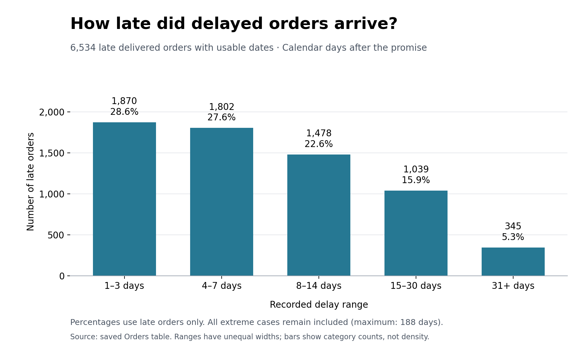
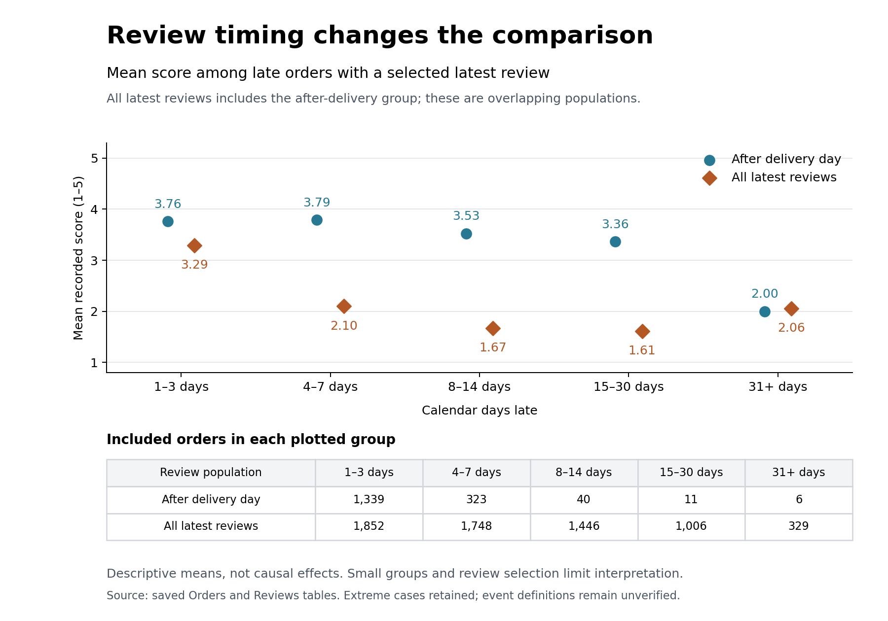

# E-commerce Delivery and Customer Satisfaction Analysis

A Python and Excel case study for an operations manager: establish delivery performance, examine the relationship between delay length and customer ratings, and distinguish analytical findings from unresolved data issues.

## Findings

- **6.77%** of assessable delivered orders arrived late: 6,534 of 96,470. Eight additional delivered orders could not be assessed because arrival dates were missing.
- Among late orders, the median delay was **7 days**, the mean **10.6 days**, and 345 orders arrived at least 31 days after the promise.
- **Review timing materially changes the score comparison.** For 4–7-day delays, the mean is 3.79 among 323 latest reviews after delivery day, versus 2.10 among all 1,748 latest reviews in that band.
- The broader score pattern is not consistently decreasing, and neither comparison establishes causation. Event definitions, selected populations and flagged records limit interpretation.

Read the [manager findings summary](reports/findings_summary.md), [timing sensitivity analysis](reports/review_timing_sensitivity.md), and [six-case comment audit](reports/review_comment_audit.md).





## Business questions and method

1. What proportion of delivered orders arrived after the promised date?
2. When an order was late, how many days late was it?
3. Among late orders, how do recorded review scores vary across delay ranges, and how sensitive is that comparison to review timing?

The source contains 99,441 unique order IDs in Orders and 99,224 review rows in Reviews. Multiple reviews can match an order, so the analysis selects one latest recorded opinion per order before comparing scores. It does not compare late and on-time review scores or establish root causes.

| Decision | Definition used |
| --- | --- |
| Delivered population | `order_status == delivered` |
| Late | Actual delivery calendar date strictly after estimated delivery calendar date |
| Days late | Positive calendar-day difference; early and same-day arrivals are zero |
| Late-rate denominator | Delivered orders with usable actual and estimated dates |
| Missing dates or reviews | Unknown/unavailable; never automatically zero, late or on time |
| Selected score | Latest `review_answer_timestamp` per order; conflicting latest-time scores unresolved |
| Primary score comparison | Late orders whose latest response is strictly after delivery calendar day |
| Timing sensitivity | All latest reviews for the same late-order population, including earlier and same-day responses |
| Extreme delays | Retained; flagged cases await verification |

See [data dictionary and decision record](docs/data_dictionary.md) for assumptions, validation and source details.

## Reproduce locally

Tested with Python 3.12 and Matplotlib 3.8.0. The inventory and analysis use the Python standard library; Matplotlib renders charts. Run these commands from the project root:

```sh
python3 -m venv .venv
source .venv/bin/activate
python -m pip install -r requirements.txt
python scripts/run_analysis.py
```

Place the original **Ecommerce_Delivery_Analysis.xlsx** in the project root before running. The workbook is preserved locally and omitted from the portfolio archive. Original download location, license and collection documentation have not been established, so no substitute download is invented. Reproduction of the results requires the same source snapshot, identified in the data dictionary.

The runner rebuilds the JSON results and both charts; it does not overwrite the workbook. Narrative reports, manual comment interpretations and the verification checklist are manually maintained and must be reviewed if the source changes. Plot scripts reject a source fingerprint that differs from the generated analysis report.

## Project files

| Location | Purpose |
| --- | --- |
| `scripts/inspect_workbook.py` | Read Strict/Transitional XLSX XML; validate and calculate delivery, review and sensitivity results |
| `scripts/run_analysis.py` | Run analysis and chart scripts in order |
| `scripts/plot_*.py` | Export PNG and SVG figures from validated JSON results |
| `reports/workbook_inventory.json` | Machine-readable results, score frequencies and traceable case references |
| `reports/findings_summary.md` | Manager-facing findings and recommendations |
| `reports/data_owner_verification_checklist.md` | Pending evidence requests and outcome template; not sent |
| `docs/data_dictionary.md` | Field meanings, analytical definitions and known limitations |
| `docs/learning_log.md` | Preserved mentoring stages, decisions and explanations |

## Validation and limits

The run checks order uniqueness, date parsing and targeted chronology, count reconciliation, saved Excel delivery labels, review selection, unique included orders and exact score-frequency reconciliation between timing groups. It checks the source SHA-256 before and after inspection. Both charts were visually reviewed.

These are descriptive findings from a saved historical dataset, not current company performance. Review availability differs sharply by delay and timing. Responses before delivery may describe waiting, not a completed delivery experience; changing populations is not a change in the same customer's opinion. Mean ratings assume equally spaced score steps. Some comments have garbled characters. Seven of the ten longest delays share one recorded delivery date, and some comments conflict with delivery records. Verification remains pending; suspected errors were not silently corrected.

## Status and next steps

The local analysis and portfolio package are prepared for review. External source verification remains open. Recommended next work: use the verification checklist to confirm definitions and flagged events, update any supported corrections in a derived dataset, then rerun and document their effects. SQL practice is an optional future extension; this project currently uses Python and existing Excel work.

The project is prepared for a private GitHub repository. The ZIP is a local review artifact and is excluded from Git. To rebuild it after changes:

```sh
python scripts/package_portfolio.py
```

The package includes code, documentation, reports and figures with a hash manifest. It excludes the original workbook, Excel owner file, Git metadata, virtual environments and caches.
